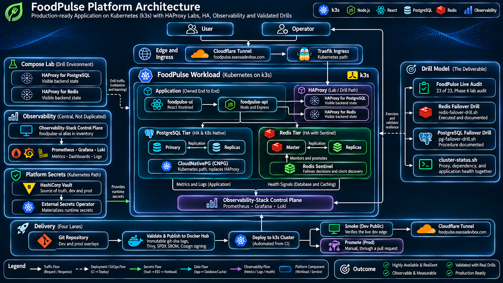

# FoodPulse

## What This Repo Is

`FoodPulse` is now a workspace-owned application and resiliency lab.

We replaced the inherited legacy runtime with an owned stack:

- a modern React UI in [ui](ui)
- a Node/Express API in [api](api)
- a Postgres primary/replica topology
- Redis replication plus Sentinel failover
- HAProxy routing for Postgres and Redis
- an owned Kubernetes path in [k8s](k8s)

In the wider workspace, `FoodPulse` is still the **resilience and failover lab**, but it now has an app surface we control end to end.

## CI/CD Workflow Model

This repository now uses four delivery lanes:

- `validate.yml`
  Repository validation for workflows, shell scripts, Node builds, YAML, and Kubernetes render checks.
- `publish-dockerhub-images.yml`
  Docker Hub publishing for the `foodpulse-api` and `foodpulse-ui` images with immutable `git-<sha>` tags, Trivy reporting, SPDX SBOM generation, and Cosign signing.
- `smoke-dev-public.yml`
  Scheduled and on-demand verification of the active public `dev` edge.
- `promote-prod.yml`
  Manual GitOps promotion that updates the held `prod` overlay through a pull request instead of changing the cluster directly.
- local and platform verification helpers
  Runtime checks also stay available in operator scripts and the shared observability plane instead of being conflated with image publishing.

For the current `dev`-first posture, `dev` follows `main` plus the mutable `dev` image aliases. That is why there is no separate manual `promote-dev` workflow today. Manual promotion remains a `prod` concern while `prod` stays on hold.

This separation keeps repository validation, artifact creation, active `dev` verification, and dormant `prod` promotion independent. That is the production-grade operating model we want across the workspace.

## Main Runtime Shape



*FoodPulse as designed: one resilience model in two honest shapes. The Compose lab keeps HAProxy in front of PostgreSQL and Redis because visible backend state makes cause and effect legible during failover drills. The Kubernetes path deliberately replaces that with CloudNativePG for PostgreSQL and Sentinel aware client discovery for Redis, with Vault as the secret source of truth through External Secrets Operator, and observability carried centrally by the Obervability-Stack control plane. The drill model is the deliverable: live audit (23 of 23 checks, Phase 6 lab audit), the Redis failover drill executed and documented, the PostgreSQL failover drill procedure, and cluster status inspected across proxy, dependency, and application together. The full design record, with the editable Mermaid source for this image, is in [docs/architecture/ARCHITECTURE.md](docs/architecture/ARCHITECTURE.md).*

The stack includes:

- `foodpulse-ui`
- `foodpulse-api`
- Redis master plus replicas
- Redis Sentinel nodes
- Postgres primary plus replicas
- HAProxy for Postgres
- HAProxy for Redis

The repo layout is intentionally simple:

- [ui](ui) contains the modern frontend
- [api](api) contains the modern backend
- [postgres](postgres), [redis](redis), [sentinel](sentinel), and [haproxy](haproxy) contain the HA lab infrastructure
- [k8s](k8s) contains the owned Kubernetes deployment model for `dev` and `prod`
- [scripts](scripts) contains operator workflows

## Workspace Integration

This repo joins the shared Docker network:

```text
observability-net
```

The user-facing app is exposed to the control plane with the alias:

```text
foodpulse-ui
```

That alias matches the inventory in the central observability stack.

Observability for this repo is handled by the central `Obervability-Stack`, not by a second monitoring stack inside `FoodPulse`.

## Local Start

From the repo root:

```bash
cp .env.example .env
./scripts/start.sh
```

If you are upgrading from an older local FoodPulse stack, run `docker compose down -v` once before the first modernized startup so the new app role and schema bootstrap can recreate cleanly.

Useful follow-up commands:

```bash
./scripts/cluster-status.sh
./scripts/docker-storage-check.sh
./scripts/redis-failover-drill.sh
./scripts/pg-failover-drill.sh
```

To stop the local stack:

```bash
./scripts/stop.sh
```

## Kubernetes Path

`FoodPulse` now has an owned Kubernetes path that intentionally diverges from the Compose lab where the platform should do better:

- Compose keeps `HAProxy` because it is useful for local failover drills
- Kubernetes replaces Postgres `HAProxy` with `CloudNativePG`
- Kubernetes replaces Redis `HAProxy` with Sentinel-aware client discovery
- `dev` and `prod` are separate overlays from the start, not an afterthought

The active local cluster path is `k3s`:

```bash
./scripts/k8s-start.sh
./scripts/k8s-stop.sh
./scripts/k8s-reset.sh --help
./scripts/k8s-dev-verify.sh
./scripts/k8s-backup-run.sh
./scripts/k8s-backup-inspect.sh
./scripts/k8s-backup-delete.sh --help
./scripts/k8s-restore-run.sh
./scripts/k8s-restore-verify.sh
```

That Kubernetes path now follows the same workspace rule as `MemFlip` and `SwiftPay`:

- Vault is the source of truth for both `dev` and `prod`
- External Secrets Operator materializes the runtime secrets inside the cluster
- `dev` keeps local `foodpulse-api:dev` and `foodpulse-ui:dev` images for fast iteration
- `prod` now expects Docker Hub-backed app images instead of repo-local `:dev` tags
- `dev` is the active runtime truth today; `prod` remains a held contract path

Authoritative Kubernetes references:

- [k8s](k8s)
- [k3s-dev-deployment.md](docs/k8s/k3s-dev-deployment.md)
- [architecture.md](docs/k8s/architecture.md)

### Kubernetes Lifecycle Controls

- `./scripts/k8s-start.sh`
  - starts FoodPulse in `foodpulse-dev`
  - if the namespace already exists, resumes preserved workloads instead of forcing a fresh deploy
- `./scripts/k8s-stop.sh`
  - safely pauses FoodPulse
  - scales the UI, API, and Redis down
  - hibernates the `CloudNativePG` PostgreSQL cluster while preserving PVCs
- `./scripts/k8s-reset.sh`
  - destructive reset
  - deletes `foodpulse-dev` and all application data in that namespace

Use `start` and `stop` for normal day-to-day lifecycle control. Use `reset` only when you intentionally want a clean reinstall.

## Backup And Restore

The owned `foodpulse-dev` Kubernetes path now has an explicit backup and restore contract.

Coverage:

- PostgreSQL business data
- Redis primary continuity state

Primary reference:

- [K8S_BACKUP_RESTORE.md](docs/k8s/K8S_BACKUP_RESTORE.md)

Fast operator checks:

```bash
kubectl get application foodpulse-dev -n argocd -o wide
kubectl get cronjob,pvc -n foodpulse-dev | grep -E 'foodpulse-state-backup|foodpulse-backup-storage|NAME'
./scripts/k8s-backup-run.sh
./scripts/k8s-backup-inspect.sh
./scripts/k8s-backup-delete.sh --keep-latest
./scripts/k8s-restore-run.sh foodpulse-postgres-YYYYMMDDTHHMMSSZ.dump foodpulse-redis-YYYYMMDDTHHMMSSZ.rdb
./scripts/k8s-restore-verify.sh
```

## Local URLs

- app: `http://localhost:8090`
- API direct host port: `http://localhost:3102`
- app health via UI proxy: `http://localhost:8090/health`
- app metrics via UI proxy: `http://localhost:8090/metrics`
- control plane app view: `http://localhost:4000/apps`

## Environment Contract

This repo expects a root `.env` file.

Start from:

- [.env.example](.env.example)

Important variables include:

- `FOODPULSE_DB_SERVER`
- `FOODPULSE_DB_PORT`
- `FOODPULSE_DB_NAME`
- `FOODPULSE_DB_USER`
- `FOODPULSE_DB_PASSWORD`
- `FOODPULSE_REDIS_SERVER`
- `FOODPULSE_REDIS_PORT`
- `FOODPULSE_REDIS_PASSWORD`
- `FOODPULSE_REDIS_SENTINELS`
- `FOODPULSE_REDIS_MASTER_NAME`
- `FOODPULSE_REDIS_SENTINEL_PASSWORD`
- `FOODPULSE_ALLOWED_ORIGIN`
- `PG_REPLICATOR_PASSWORD`
- `FOODPULSE_UI_HOST_PORT`
- `FOODPULSE_API_HOST_PORT`
- `FOODPULSE_SENTINEL_HOST_PORT`
- `FOODPULSE_PG_RW_HOST_PORT`
- `FOODPULSE_PG_RO_HOST_PORT`
- `FOODPULSE_REDIS_HOST_PORT`

The default host-port contract is intentionally normalized so this repo can run beside the workspace control plane without colliding with shared ports or generic container names.

## Kubernetes Readiness

The owned app surface is now structured to translate cleanly into Kubernetes:

- separate UI and API images
- environment-driven runtime contracts
- dedicated health endpoint
- dedicated metrics endpoint
- `CloudNativePG` for PostgreSQL failover and service discovery
- Sentinel-aware Redis failover without an application-owned proxy
- explicit `dev` and `prod` overlays
- a separate image-publish and GitOps-promotion workflow model

## Known Caveats

- `scripts/pg-failover-drill.sh` is intentionally a manual lab drill, not a production failover controller
- the Compose Postgres and Redis HA topologies are educational and operator-friendly, not full self-healing platforms
- the Kubernetes `prod` overlay is a deployment contract, not a fully exercised production environment yet
- the central control plane currently blackbox-checks the browser surface; it does not yet scrape the new API metrics endpoint directly

## Operator Notes

Run `./scripts/docker-storage-check.sh` during incident triage or before demos if the local Docker runtime has been carrying multiple projects for a while. It reports:

- overall Docker storage usage
- each FoodPulse container's logging policy
- the largest Docker `json-file` logs it can inspect from the local runtime

The current `FoodPulse` Compose file does not pin `platform:` to `linux/amd64`. If Apple Silicon hosts still show AMD64 warnings for Redis or HAProxy, that comes from the local Docker image/runtime state rather than the repo configuration. In that case, inspect the local image platform selection and refresh the affected images if needed.
