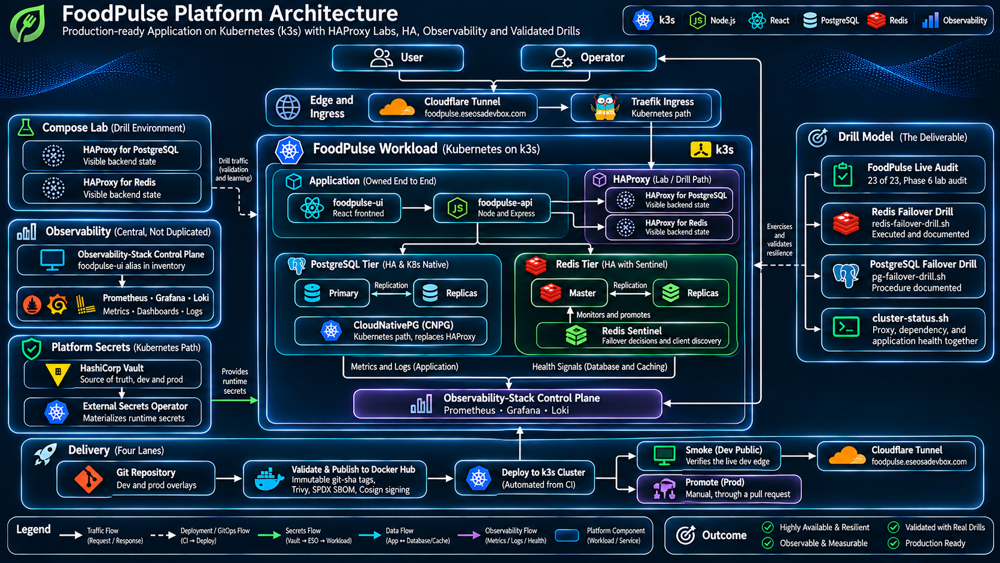
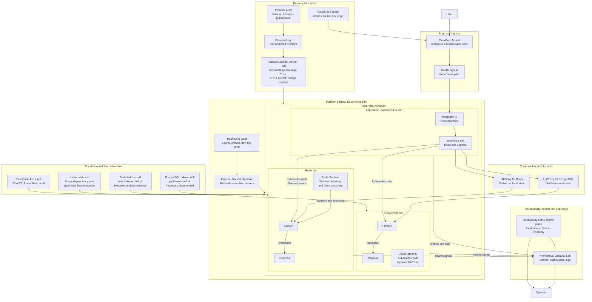
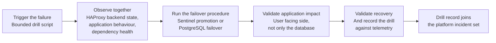

# FoodPulse Platform Architecture

This document is the architecture design of record for the FoodPulse Resilience Lab. The image above is rendered from the Mermaid source in this file, so the picture and the source never drift apart.

## The design in one paragraph

FoodPulse treats high availability as something to prove, not to draw. The owned application (React UI, Node and Express API) sits in front of two data tiers: PostgreSQL primary plus replicas, and Redis master plus replicas watched by Sentinel. In the Compose lab, HAProxy fronts both tiers because an operator can inspect backend state directly during a drill, which makes cause and effect legible. On the Kubernetes path that proxy tier is deliberately removed: CloudNativePG manages PostgreSQL, Sentinel aware client discovery handles Redis, Vault is the secret source of truth for dev and prod through External Secrets Operator, and dev and prod are separate overlays from the start, with dev the active runtime truth and prod a held contract. Observability is central, not duplicated: FoodPulse joins the shared observability network and appears in the Obervability-Stack control plane under the foodpulse-ui alias. Delivery runs four lanes: validate; publish Docker Hub images with immutable git-sha tags, Trivy reporting, SPDX SBOM generation, and Cosign signing; smoke verification of the public dev edge; and manual prod promotion through a pull request. Validation is the drill model: trigger a bounded failure, observe proxy, application, and dependency together, run the failover procedure, validate application impact and recovery, and record the drill against telemetry (live audit 23 of 23 checks, Phase 6 lab audit).

## Architecture diagram, Mermaid source

## Flow diagram: a failover drill, Mermaid source

## Notes

- Lab environment. Failover results demonstrate procedure and behaviour at lab scale, not production load or multi site resilience.
- Audit counts are point in time lab validation results documented in the platform repository.
- Live application: `https://foodpulse.eseosadevbox.com`.
